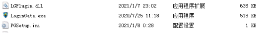
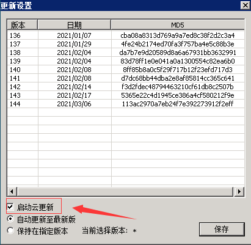
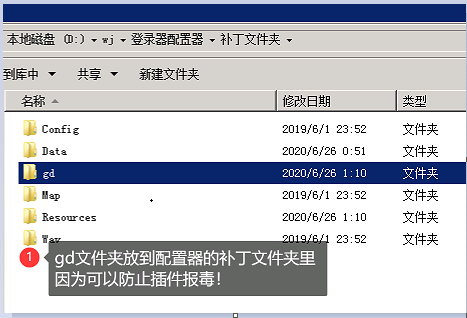

# 安装说明

G盾盘古插件是G盾的专用功能扩展插件，正常使用G盾的客户无需客户端插件，只需安装盘古的M2插件就可以安心使用。如果要使用盘古插件做版本，只需要使用登陆器配置的时候集成盘古单机客户端插件，并安装上盘古M2插件就可以，目前盘古插件可以免费使用。

第一步安装M2插件

以绿盟为例，安装顺序为：

IPLocal.dll

945Engine.dll

PGM2Plugin.dll

GdunExtendX86.dll

如果是单机 测试 写版本

IPLocal.dll

945Engine.dll

PGM2Plugin.dll

第二步更换PG专用的防扫号网关以及插件

第三步集成客户端插件

注：防扫号网关1.7以上版本打开云更新即可如下图

老版本如下：

！注 ：以上步骤缺一不可
