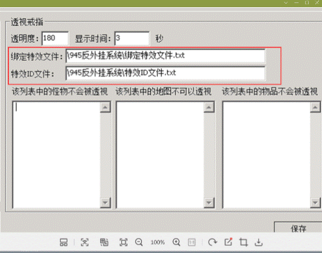

# 爆率透视

爆率透视

3.32版本增加了
爆率透视
命令：PGSeeDrop

参数1：范围
参数2：数据保留时间，单位分钟

未使用G盾用户

请在这里写入所用绘制光柱插件的绑定特效文件以及特效id的txt文件所在目录!

注：透明度越高越清楚
注：屏蔽列表一行写一个

加到不同触发字段下面可能会有不同的效果
例如：

[@attack]
　　；攻击触发
[@walk]

；走路触发
[@run]

；跑步触发
[@MagSelfFuncX]
；技能触发
X指技能id
...

例子：
；攻击触发

[@attack]
#if
#act
M.PGSeeDrop
0 3
SENDMSG 6 你已经透视了当前攻击怪物的爆率，数据保留时间为3分钟

；穿戴某物品触发
比如木剑

[@attack]
#if
checkitemw
木剑
#act
M.PGSeeDrop
0 3
SENDMSG 6 你已经透视了当前攻击怪物的爆率，数据保留时间为3分钟

；背包携带某物品触发
比如透视戒指

[@attack]
#if
checkitem
透视戒指
#act
M.PGSeeDrop
0 3
SENDMSG 6 你携带透视戒指透视了当前攻击怪物的爆率，数据保留时间为3分钟

;移动触发

[@walk]
#if
#act
PGSeeDrop
3 5
SendMsg 0 你已经透视了范围3以内的怪物的爆率，数据保留时间为5分钟
[@run]
#act
PGSeeDrop
3 5
SENDMSG 6 你已经透视了范围3以内的怪物的爆率，数据保留时间为5分钟

玩家需要在数据爆率时间内打死怪物，怪物爆出物品才会和透视结果相同。

反之，如果玩家透视了教主爆开天，花了很久的时间打死，已经超出了数据保留时间，那么教主死了就不一定会爆开天了
