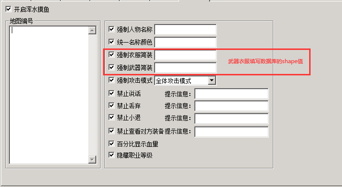
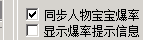
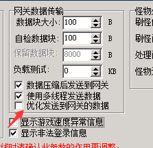

# 浑水摸鱼

浑水摸鱼

PG3.3.7版本增加了浑水摸鱼功能

开启浑水摸鱼的地图隐藏所有玩家称号，封号，宝宝名称，装备特效等功能
注：

   1 名称颜色 参考引擎颜色值列表

 

   2 关于shape值，表示物品穿在身上的样子，具体自行查看物品数据库第三个参数

   3 隐藏宝宝名称需要开启宝宝同步爆率

4 如果发现功能未生效检查是否勾选了优化发送到网关的数据

 m2→选项→性能参数

5 浑水摸鱼地图切勿频繁使用范围吸怪

 6 增加一个常量 判断是否开启浑水摸鱼 <$PGMASKEDFIGHT>  1是0否

 可用于屏蔽全服公告，攻击触发等脚本功能

 7 强制攻击模式 需要先开启禁止说话 否则不生效
