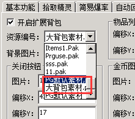
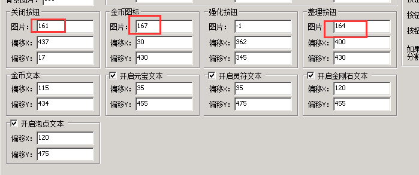
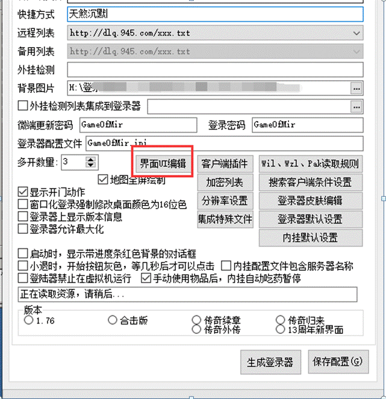
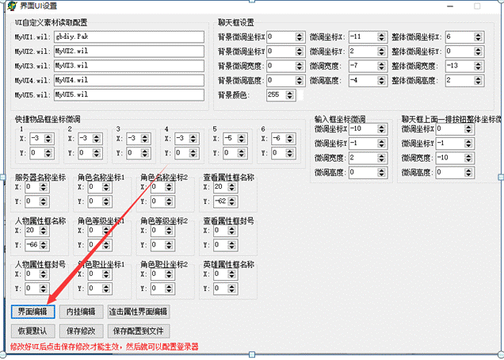
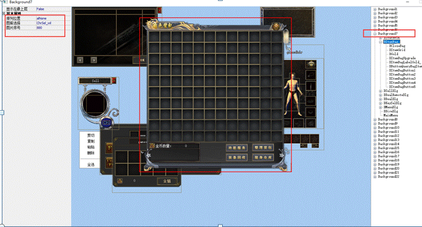
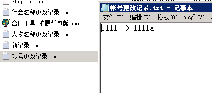

# 扩展大背包的各种问题

关于扩展大背包安装失败的问题：
需要替换PGm2插件，
客户端pak，引擎控制台，DB
少一步m2会出现如下提示

关于我想使用自己背包素材这个问题：
把自己想要替换的素材做成pak集成到客户端，然后在pg插件上选择添加的素材

然后根据pak顺序调整素材位置(背景，刷新按钮，关闭按钮等)

关于背包拓展按钮位置不对的问题：

1∶

**首先启动登陆器配置器**

**点击界面UI编辑-界面编辑-OK**

**然后找到包裹的窗口，鼠标点一下包裹窗口，右边的窗口会有名称，DItemBag\_，在这个下面找到 DItemBagButton1
DItemBagButton2 DItemBagButton3 DItemBagButton4
DItemBagButton5
这5个按钮点击会分别触发QF的[@ItemBagButtonClickX]，默认是隐藏的，不显示的，并且没有素材显示，需要设置素材。
鼠标选择其中一个按钮，比如点击DItemBagButton1，然后在左边的窗口，双击图片，就可以设置素材了**

2∶

3∶

4∶天煞沉默按钮坐标参考
如图

功能按钮
上,434
左,296

回收按钮
上,467
左,296

仓库按钮
上,467
左,386

关于开区助手以及合区工具的兼容
问题1：
开测试区之后的清理数据问题
答：使用我们提供的GameOfMir引擎控制器替代版本内的，大多开区助手清理数据的时候都是使用的引擎控制器去清理的则兼容，如果不是引擎控制器清理的数据的那种开区助手就无法兼容

问题2：
开区助手和其他一些一键合区工具合区兼容问题
答：我们提供了一份由原版合区工具改出来的合区工具，使用我们这个合区工具可以确保合区的时候多出来的背包物品不丢失。
如果合区工具合区的时候是调用的原版合区工具的话，让他调用我们的合区工具就可以兼容。
如果是他们第三方的4合一8合一的那种合区工具则无法兼容目前的合区
问题3：
合区以后大背包物品只有46个
答：同账号玩家合区以后，系统会默认账号末尾加a，b，c...所以从区玩家用原账号登录主区客户端，实际还是读取的从区数据库里的物品
（只有46个），

