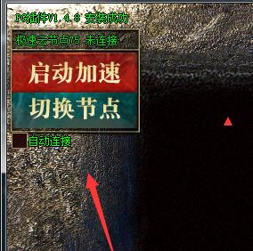
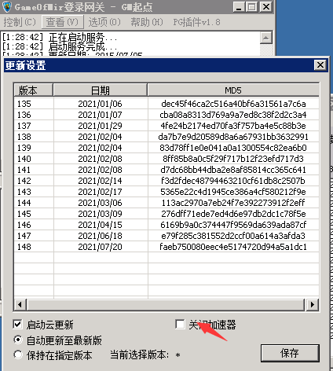
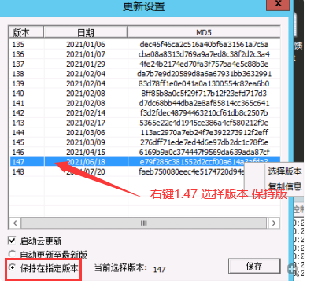

# 网络加速器

相信大家都发现游戏里多出了一个启动加速的按钮，这是一个类似27，3t的加速器。
更新这个插件主要是为了解决。
1.联通，移动，长城线路的玩家没有电信快的问题。
2.开了27代理的玩家出刀比没开的人快的多的问题
3.为了玩家流畅度问题，大家多花了钱买bgp线路问题
这所有的节点，全部来自腾讯云，玩家使用加速之后，相当于你们使用了腾讯云的优质线路在开区
同时，也解决了服里总有人开27，3t之类导致打架比别人厉害，投诉不断的问题
这个插件我们后续还会开放单独版本，给用了gom但是没用pg插件的GM一同使用，插件免费，一年之内不会收费，请大家放心使用。
另外加速器我们有正规资质的，如果有人攻击我们节点，直接报案解决

关闭按钮在登录网关勾选 点击关闭即可

备注说明：
因为部分gm没有更新PG1.8的登录网关， 导致没有关闭按钮

其他版本 如图操作即可关闭加速器

