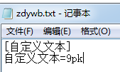
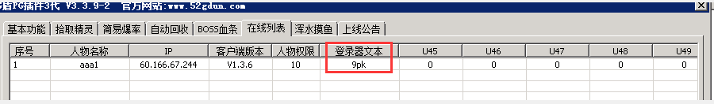
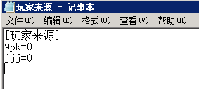

# 读取登录器自定义文本功能

PG3.3.9-2新增读取登录器自定义文本功能

通过该功能可以用来记录 玩家来源的发布站数量
该功能需要更新客户端插件（pg助手版本号1.3.6）

使用说明：
在登录器data目录下建立 zdywb.txt
txt格式为：

[自定义文本]
自定义文本=
如图：（举例内容为9pk发布站 ，gm根据自身情况修改）

新号第一次上线 , 会触发QF里面的  [@PG版本自定义标记文本] 字段
增加一个相关常量 <$PGCLIENTTEXT>

常量内容为 自定义文本内 等号 之后的内容（如上图的话应为9pk）

例子1：
gm可在pg插件的在线列表查看

例子2：（举例内容为9pk和jjj两个 发布站 gm根据自身情况修改）
首先在QuestDiary文件夹下面建立一个 玩家来源.txt
txt内容如下：

[玩家来源]
9pk=0
jjj=0

然后在qf 添加如下脚本

[@PG版本自定义标记文本]

#act
PGReadConfigFileItem ..\QuestDiary\玩家来源.txt 玩家来源 <$PGCLIENTTEXT> N$数量
PGDelConfigFileItem ..\QuestDiary\玩家来源.txt 玩家来源 <$PGCLIENTTEXT> N$数量
inc N$数量 1
PGWriteConfigFileItem ..\QuestDiary\玩家来源.txt 玩家来源 <$PGCLIENTTEXT> N$数量
