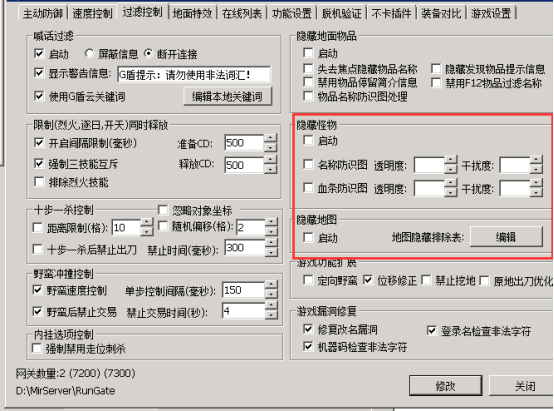
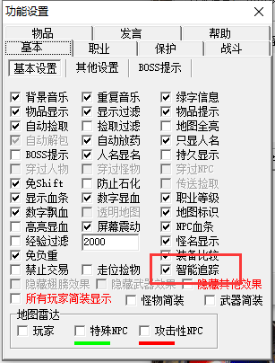
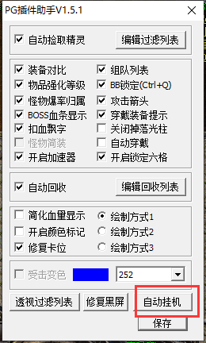
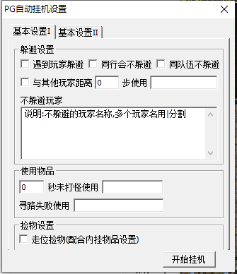
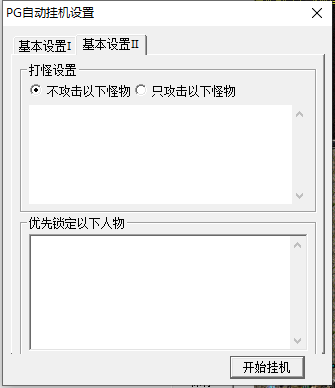

# 自动挂机介绍

应广大GM要求g盾推出了自动挂机功能
自动挂机功能说明：
特别说明 此功能需要更新服务端插件（PG3.45）以及客户端插件（PG助手V1.5.1）

G盾用户按说明添加完脚本发现功能未生效 ，可以检查下是不是勾选了

怪物隐藏和地图隐藏

开启挂机后发现人物撞墙，看下内挂是否勾选智能追踪

开关写在qm上线点开始挂机无反应。可能是服务端执行过快 客户端未能反应
在脚本前加个延迟跳转即可 如下：

[@Login]
#ACT
DELAYGOTO 10000 @自动挂机

[@自动挂机]
#act
PGOpenAutoPlayGame

自动挂机相关界面：

多个人名 怪物名均是拿|分割
