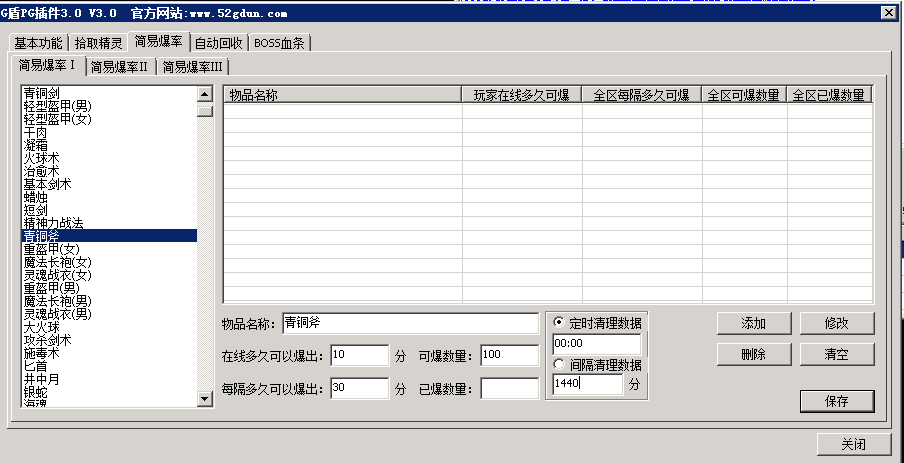

# 简易爆率1使用说明

简易爆率1使用说明

如图

在线多久可以爆出：该功能用于控制人物在线多长时间方可掉落物品，每次小退则该时间重置为0，如上图的意思是人物上线满10分钟后才有机会掉落青铜斧，如果人物小退，则这个时间重新开始计算。
每个多久可以爆出：该功能用于控制区里面物品掉落的间隔，如上图的意思该区的青铜斧每把掉落的间隔时间至少需要30分钟，比如A玩家在12点打出一把，那么B玩家乃至任何玩家至少在12点30分以后才有机会打出青铜斧
可爆数量：该功能用于控制区里面某个物品产出的总数值，如图的意思是青铜斧这个区最多只能产出100件
已爆数量：该功能用于控制区里面某个物品已经爆出来的数量，当这个值等于可爆数量之后，这个物品将不再产出
定时清理数据：该功能用于控制定时清理已爆数量，如果的意思每天的00时00分则清理这个区的已爆数量。该功能清理的时整个简易爆率1表中的已爆数量而不是某一个指定物品的。格式为小时:分钟。01:02代表凌晨1点02分，00:00代表凌晨12点整。注意中间的冒号一定要使用英文字符
间隔清理数据：该功能用于控制每次自动清理数据的间隔时间，如果选中后那么上图的意思是开区1440分钟后自动清理掉已爆数量，然后1440分后再次清理
