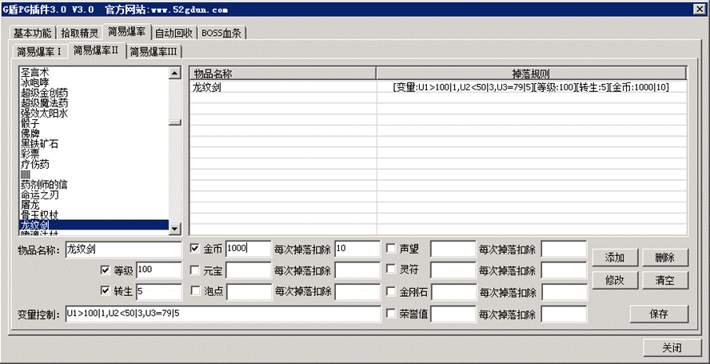
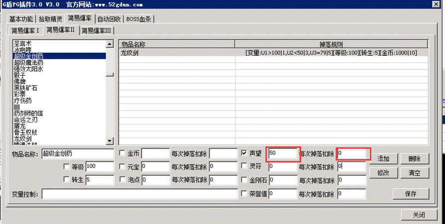

# 简易爆率2使用说明

简易爆率2使用说明

如图

上图的意思，龙纹剑需要玩家等级大于100级，转生等级大于5级，金币大于1000个，而且变量U1大于100、U2小于50、U3等于79时才有机会掉落
每掉落一件则扣除玩家金币10点，变量U1的值会被减去1，U2的值会被减去3，U3的值会被减去5，记得不要把金币扣成负数了，条件要比扣除要大一点
变量控制支持多个不限制数量，支持的逻辑关系为大于(>)、小于(<)、等于(=)
变量支持自动扣除，用|符号分开，如U1>100|7
意思是U1的值大于100，当掉落时U1的值会被自动减去7
每组变量条件中间使用英文字符的逗号【,】分割开

注;设置条件和扣除的时候，注意左边要大于等于右边！不然会扣成负数，导致数字溢出，变无限大
