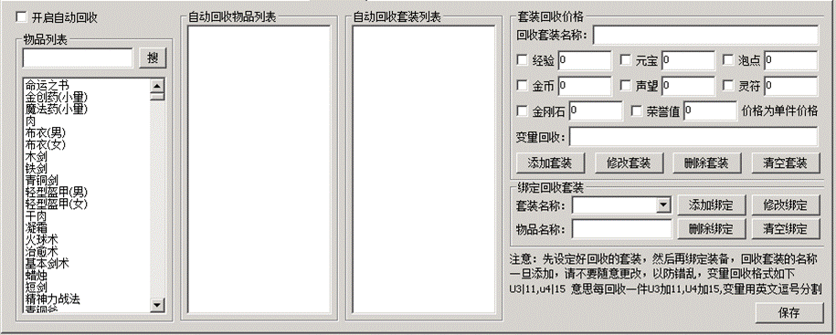
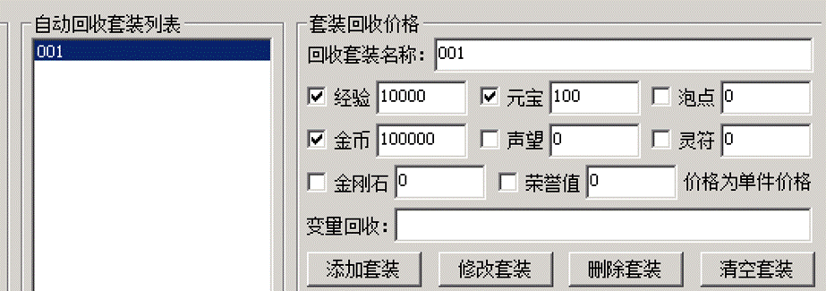
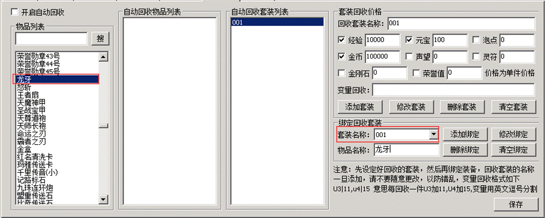
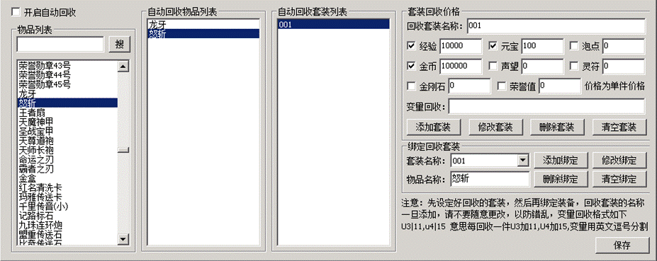
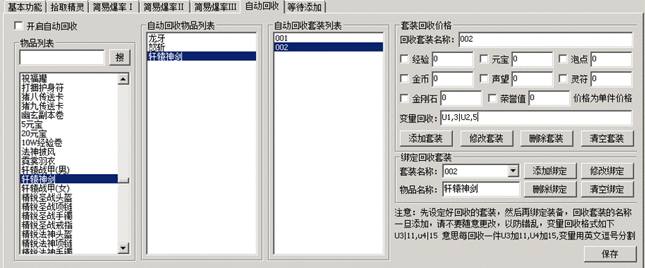

# PG插件自动回收设置教程

PG插件自动回收设置教程

先增加一个套装，比如叫001回收，或者叫初级回收，叫啥无所谓，游戏里也不会体现出来，自己看起来方便即可。
然后设置下这个套装，他回收的时候给多少元宝或者经验

第二步，左侧物品列表那，选择一些物品，加入这个001里

这里套装001，回收给元宝是100，意思是，龙牙回收=100元宝，怒斩回收也是100元宝，这个设置的回收价格是每一件单件的价格。

变量回收，意思是回收的时候给某个变量加数值，比如一些装备回收RMB点，可能就用到这个功能。
格式是U1|3,U2|5
意思是，回收一件，U1+3，U2+5
每组变量条件中间使用英文字符的逗号【,】分割开

比如这把轩辕神剑，回收价格就是，变量U1+3 变量U2+5

