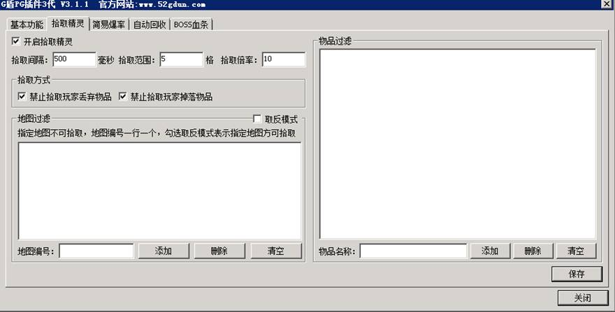

# 开启自动捡物

开启自动捡物

脚本开启和关闭自动捡物，该命令控制的是单个玩家
PGStartAutoPickItem

参数1=是否开启自动捡物，1开0关

[示例]
#if
#act
PGStartAutoPickItem 1
SendMsg 6
你已经打开该玩家的自动捡物功能

相关扩展常量：

|  |  |
| --- | --- |
| <$PGAUTORECOVERITEM> | 自动回收物品名称 |
| <$PGAUTORECOVEREXP> | 自动回收经验 |
| <$PGAUTORECOVERGAMEGOLD> | 自动回收元宝 |
| <$PGAUTORECOVERGAMEPOINT> | 自动回收泡点 |
| <$PGAUTORECOVERGOLD> | 自动回收金币 |
| <$PGAUTORECOVERCREDITPOINT> | 自动回收声望 |
| <$PGAUTORECOVERGAMEGIRD> | 自动回收灵符 |
| <$PGAUTORECOVERGAMEDIAMOND> | 自动回收金刚石 |
| <$PGAUTORECOVERGAMEGLORY> | 自动回收荣誉值 |
