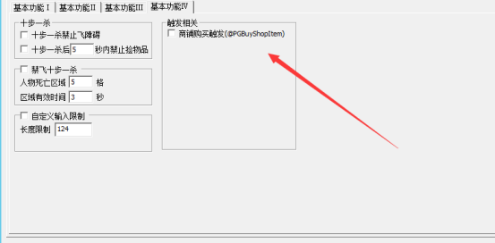

# 购买商铺物品触发

PG3.49增加了购买商品触发字段
@PGBUYSHOPITEM
使用该功能需要现在m2开启该功能

相关常量：
<$PGSHOPSELLER>|商铺卖家名称
<$PGSHOPITEM>|商品名称
<$PGSHOPITEMIDX>|商品序号
<$PGSHOPITEMPRICE>|商品价格
<$PGSHOPITEMMONEYTYPE>|商品货币类型

注：商品货币类型中
512
指金币
256
指泡点
0N
指元宝
