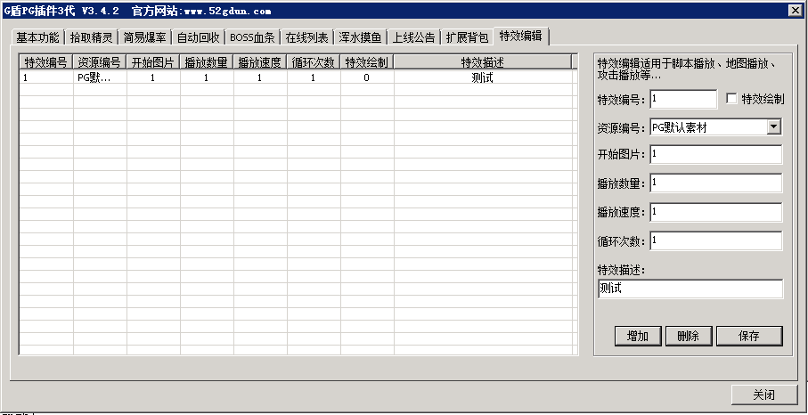

# 范围伤害

PG3.42新增范围伤害
PGRangeHarm
参数1 X坐标
参数2 Y坐标
参数3 范围
参数4 伤害值
参数5 附加效果
0=无，1=击退，2=冻结，3=麻痹，4=吸血，5=吸蓝，6=真实伤害，7=冰冻，8=蛛网效果，9=红毒，10=绿毒
参数6 附加属性值 分别对应 击退距离 冻结时间 麻痹时间 吸血值 吸蓝值 真实伤害值
参数7 判断类型 0打击所有目标 1只对人物 2只对怪物
参数8 最大打击数量 0代表范围内所有目标
参数9 是否触发QF
0不触发、1触发，当受到此命令打击的人物(参数4有伤害值才行),触发QF中的[@PGRangeHarmX],X代表附加效果序号

参数10 播放自身特效编号 0代表没有,特效编号,在下图界面编辑

实例：

[@attack]
#act
PGRangeHarm  <$X> <$Y>  8 100 1
5

；当前地图 人物坐标范围8之内所有可以攻击的目标都受到100点伤害，并且被击退5格

注：伤害和普通伤害一样，需要考虑目标的防御
