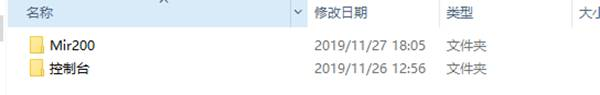
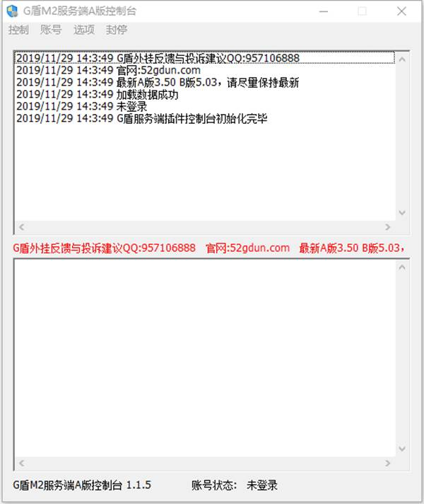
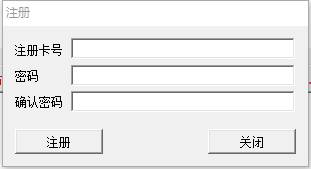
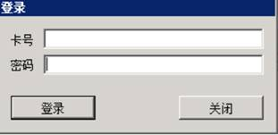
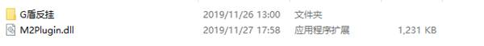
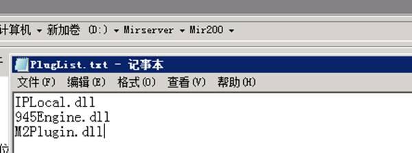
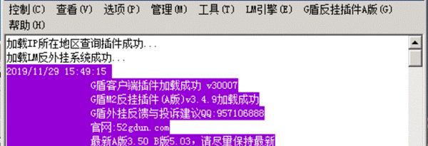

# A版安装说明

A版安装说明

A版下载完成后解压到桌面，打开有包含Mir200和控制台2个文件夹，如下图

打开控制台目录下的 控制台.exe

点击账号-注册

在注册卡号中填入购买的卡号，自己输入一个密码，然后点击注册按钮

注册成功后，点击控制台上的账号-登录，登录您注册的账号和密码
打开Mir200文件夹，里面包含G盾反挂文件夹和一个M2Plugin.dll文件，将这2个全部复制粘贴到您的区目录下的Mir200文件夹内

打开区目录下的Mir200\PlugList.txt，在尾部添加上M2Plugin.dll，如下图

到了这里，整个G盾A版的安装就完成了！
