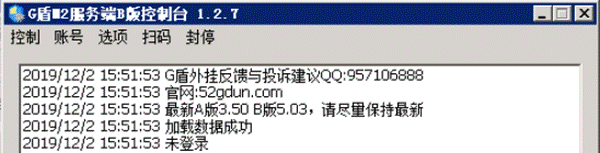
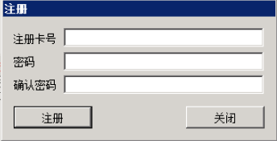
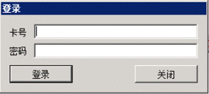
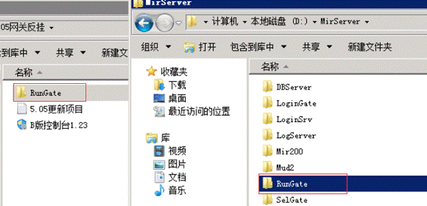
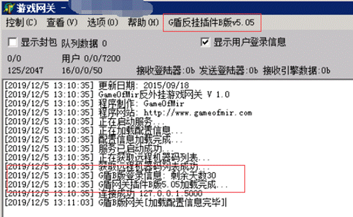
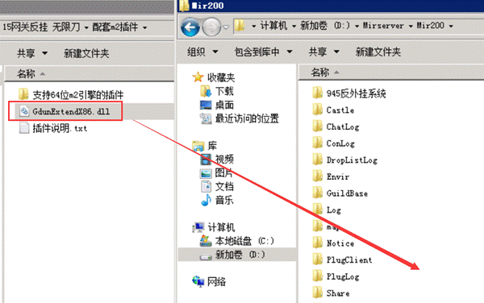
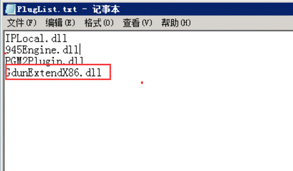
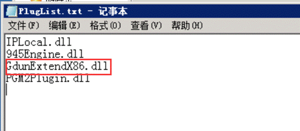

# B版安装说明

### **B****版****5.0****以上为纯网关封挂**

下载了B版之后，解压，打开控制台
1.打开控制台

点账号-注册

然后点账号登陆

登录成功之后，控制台可以最小化，但不要关闭，如果服务器重启了，重启之后记得重新打开控制台，否则会出现玩家上线掉线的情况

2.覆盖文件
我们把解压出来的G盾里的rungate文件夹，覆盖掉mirserver内的rungate

3.在引擎控制台上，点向导，然后一直下一步下一步。然后开启，启动游戏之后，看到rungate上有G盾版本就安装成功。

4.新版的b版还有一个m2被套插件，放到mir200文件夹啊，然后添加到pluglist.txt里，注意顺序

或者

