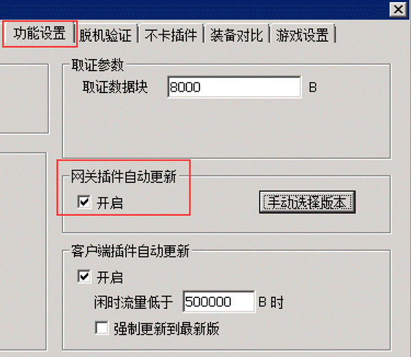
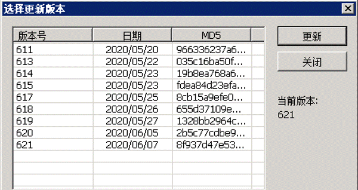
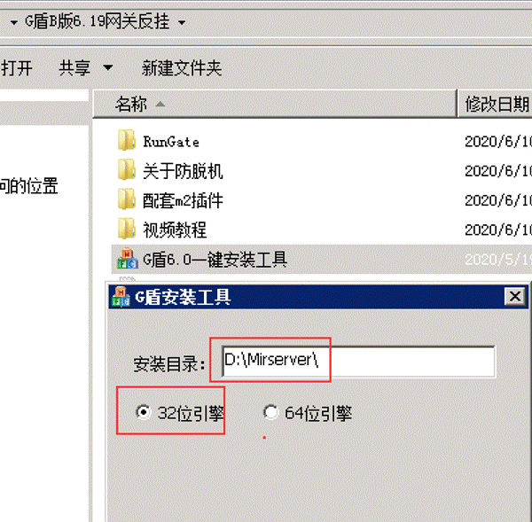
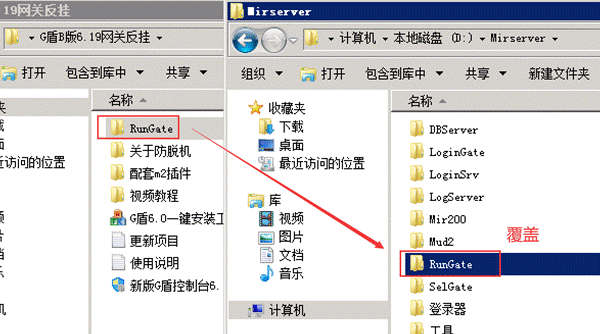
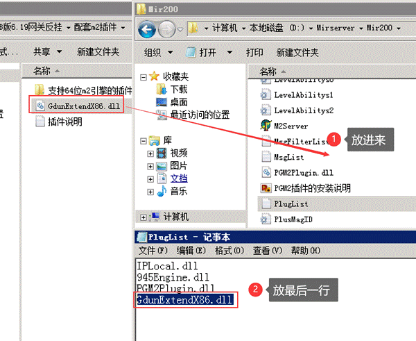

# B版6.xx安装说明

B版6.xx安装说明
G盾从6.0开始，采用自动更新来更新插件，自动更新可以保证每一个人能及时的使用最新版本，同时也允许退回到之前的老版本。

当希望退回之前版本，只需要关闭开启，点击手动选择版本即可

下面说安装教程
1.使用快捷工具安装

第一步，设置好安装目录和引擎
这里有人不知道自己是什么引擎的，这种指的是不是服务器系统32还是64
99%的都需要默认32位引擎，64位引擎是大服专用，红色的m2
第二步，在关区的状态下，点击安装按钮即可，一定要关区

2.手动安装
第一步，覆盖rungate

第二步，安装配套的m2小插件

