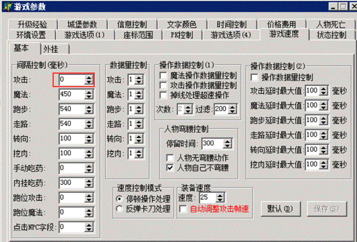

# 180超速、201超速问题

180超速，或者201超速的问题。
A版主要表现是180，B版表现为201，这2个意义是一样的，只是版本不同编号不一样。
这个问题，如果是个别人出，则可能是开挂导致。但是还有种情况，因为M2上的参数设置的不合理导致玩家的出刀速度，会在一段时间之后，偶发性的会突然加快，这导致触发了G盾的限速系统。
一般出现这个问题的，请点开M2-参数设置-游戏速度这里

这里的攻击是0，这里如果为0的话，就容易出问题，我建议大家这里设置个其他数值，比如1，100啥的。
