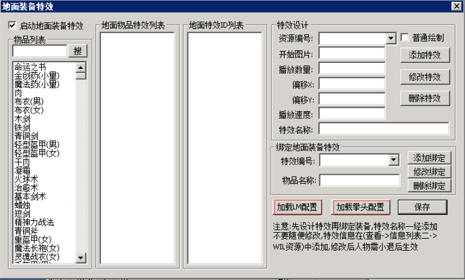
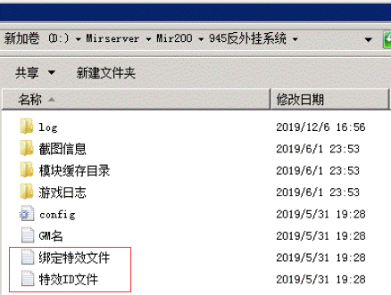

# 不显示光柱问题

### **很多人会遇到不显示光柱或者光柱歪了的问题**

因为检测挂机外挂的需要，G盾对游戏内的地面物品数据进行了动态加密，这导致了原本绿盟、皓月、PJ、XF等光柱并不能正常显示。

**为此我们自己做了一个光柱系统，对于使用量最多的绿盟用户，只需要点击加载绿盟即可****,****如果是其他登陆器，需要手动来添加光柱了。**

如果是B版用户，则需要手动把mir200/945反挂系统里面的特效ID文件.txt和绑定特效文件.txt，手动复制到rungate文件夹内

至于其他插件的光柱，方法都大同小异，自行研究下就明白了。
