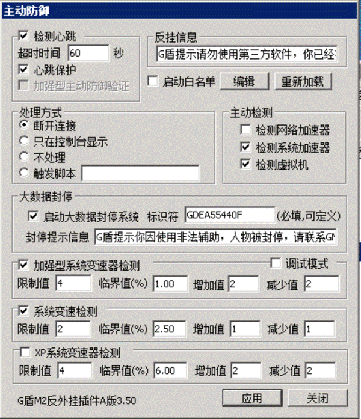
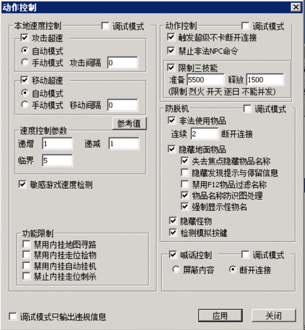
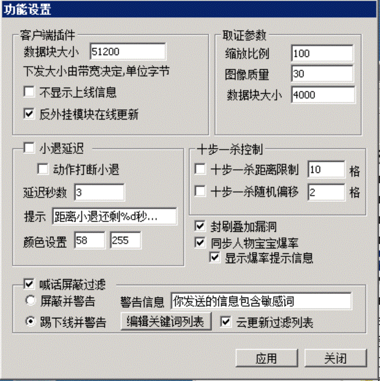
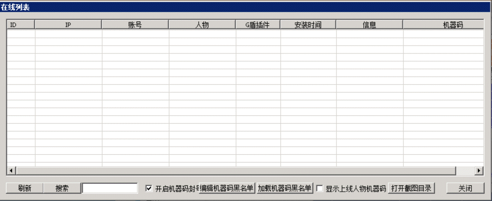
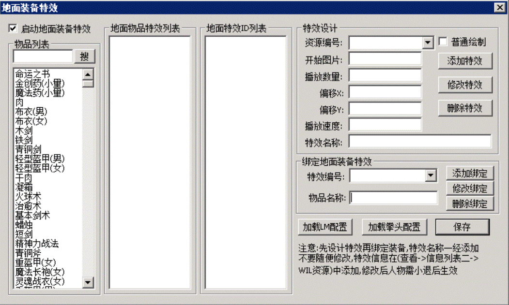
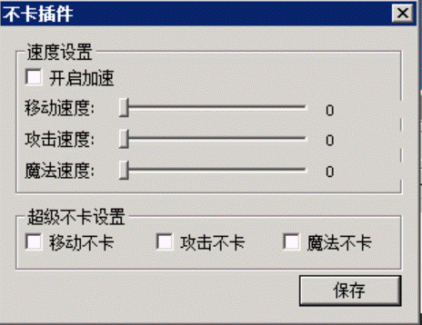
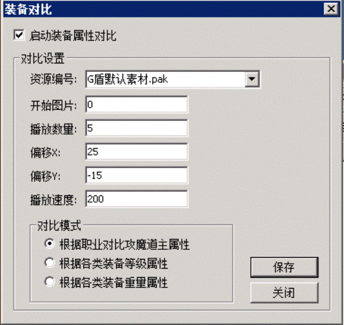

# 功能介绍

功能介绍

\*\*G盾的功能简介：

\*\*

1.检测心跳：检测未加载G盾成功的人，这里默认60秒，如果60秒内未加载G盾，则T下线

2.反挂信息提示：G盾提示请勿使用第三方软件，你已经掉线！ 这个提示可以改

3.启动白名单：G盾的检测众多，我们每更新一道检测都追求万无一失，慎之又慎，基本没有误封，但是万一出现这样的情况的话，你可以反馈给我们，也可以给玩家加白名单，白名单的格式是：张三 20201
这里我们假设张三这个人被检测掉线的代码是20201，我们就勾选启动白名单，这样设置

4.处理方式：就是玩家开挂被检测到之后如何处罚，掉线，或者不掉线，或者触发脚本，拉去坐牢

5.主动检测：检测网络加速器，即27代理。 检测系统加速器，是检测一部分宇宙变速器，守望者变速器这类整体加速器的。 检测虚拟机，是防止虚拟机多开游戏的

6.大数据封停：处罚开挂玩家并不是目的，让他们和谐游戏，好好玩游戏才是目的。 大数据系统智能分析，对于开挂情节严重的玩家，给予临时的封号处理，如果还想继续游戏，必须找GM解封。
以往的处理方式，导致一些玩家开挂成习惯， 外挂更新就开起来爽爽，外挂被封就不开。 这种方式的机制永远也消灭不了游戏内的挂B玩家。所以我们才做了这套劝人向善的系统。

7.系统变速器检测，这里有3道，都是从行为结果上的来检测系统变速器，就算变速器可以开，也不能随便拉加速，只要拉了就非常可能被检测到，目前加强型的检测可以精确到1.01不误封，还有一道专门针对XP玩家的系统变速器检测，有需要的可以开。

1.攻击超速，移动超速。 这是G盾的主要限速系统，这道系统保证了，就算是外挂可以开的时候，速度也不能上天。
G盾读取了M2上的各个设置，来自动设置限速标准，在出刀不快的服，这个限速非常精准，可以让外挂速度一点不能增加， 在出刀很快的服里要稍差一些。 我们可以开启调试模式可以清楚的看到游戏内所有玩家的移动和攻击速度， 这个速度有2个值：理论值和实际值。 理论值代表的是游戏的设定速度，也就是G盾的限速标准，实际值代表的是玩家真实的出刀速度。 理论值和实际值的差20以内，则外挂无法加速，只要拉了速度必掉。 一个服的速度并不是胡乱设置的，如果设置的不好，就会导致理论值和实际值的差值很大，就会导致可以被外挂加速的可能性，当然前提是外挂没有被G盾主动检测检测到的情况下。 这是一门很难掌握的技术，希望大家有空多研究

2.动作控制。 禁止超级不卡：以前开启外挂的超级不卡功能可以让出刀速度明显快于常人，这道检测彻底灭杀了外挂上的超级不卡功能，现在的外挂上已经没有这个功能了。如果你打算开一个刀速版本，无限刀版本，那么也请你关闭此功能
禁止NPC命令：这是禁止外挂直接调用NPC命令来点击NPC和回收的， 这道功能的出现导致了大多的脱机挂变成了模拟按键的方式

3.禁止三技能：也就是禁止烈火+逐日+开天斩 三刀连续释放，产生巨大杀伤的功能，目前A版的限制三技能留有一线，当玩家连续准备技能，不出刀一直憋技能，10秒左右还是可以出三技能的。这种操作外挂可以使用，手动按也可以使用
如果后续反馈三技能的太多，我会进一步强化这个检测，彻底让三技能永远无法连放。 至于某些人说的一刀打出去，三个技能同时出现，我是没见过，如果你见过请发小视频给我们长长见识。

4.隐藏地面物品：非常强力的功能：对游戏内爆出的地面物品进行处理，使之加密，让外挂无法识别地面上的东西，从而达到禁止外挂自动捡东西的功能
隐藏怪物：也是强力功能，对游戏内的怪物进行加密，让外挂获取不到怪物正确的位置

5.功能限制：这里目前只有一个禁止内挂走位刺杀可以使用，根据需要选择

6.禁止喊话：这里禁止的是外挂的内存调用自动喊话功能

1.客户端插件大小：只有在控制台上设置手动更新的情况下才会用到这里，保持默认即可
反挂模块在线更新：当G盾云更新的时候，在线的玩家也会实时同步更新到最新G盾，如果不开启，则玩家会在他小退之后云同步到最新

2.取证参数：这里的数值是控制取证玩家桌面图片的清晰度的

3.小腿延迟：让玩家游戏内小退多了一个等待时间，如果勾选了动作打断，则小退等待的过程中，人物不能移动，动了就取消小退

4.十步一杀控制：限制了十步一杀的距离，还可以让十步一杀飞的不准，会随机偏移，这让玩家使用十步一杀来抢装备出现更多的变化，也让外挂上的十步一杀抢装备功能失效

5.封刷叠加物品漏洞：我们封了一种叠加的情况，并不是全部，毕竟我们不是专业干这事的
宝宝爆率同步：应一些GM需求增加的，可以让人物爆率提升的时候BB也提升爆率，不会出现人物爆率高，BB爆率低的情况

6.喊话屏蔽过滤：封一些免费挂的喊话，以及游戏内的脏话骂人的关键词

在线列表里，主要是查询玩家状态和机器码相关的东西
1.取证：选择一个玩家，右键他，可以取证列表和取证截图。 可以看到玩家电脑的部分进程和桌面

2.在线列表显示了每一个玩家的IP，账号，人物，G盾插件情况，安装时间和机器码
如果出现有人一直未安装G盾的，请手动T除。 获取到的机器码可以用来封机器码，可以在这里封，这样可以封一个区，也可以在控制台上封，这样这服务器上所有区都会生效

地面特效：因为G盾的隐藏地面物品会导致登录器自带的地面特效失效。我们只好自己做了一个地面特效功能。
如果原特效是绿盟或者拳头的，转换为G盾特效只需要点下加载LM，加载拳头的按钮就一件转化好了。
如果是其他的特效，则需要手动添加了。 如果万一到一些特效位置偏了的问题，请自行调整下坐标即可

不卡插件是无限刀插件，之前是单独售卖的，后期直接集成在了G盾上
可以勾选开启加速，然后拉移动，攻击，魔法速度。 这里我建议只拉攻击和魔法，移动速度不要在这里调整，在M2上调整更好。我遇到过在这里调整移动速度的导致了游戏内跑动出现残影
超级不卡设置，这里也不要勾选移动不卡，因为可能会导致跑动的时候出现空气墙，把人回弹回来。
所以：一般拉动攻击速度，魔法速度。 勾选攻击不卡，魔法不卡。

装备对比功能，是为了更加直观的显示包裹内哪些装备比身上的好。
这里可以选择默认素材，也可以自定义素材。 选用默认素材会直接生效，选用自定义的，需要事先把自定义素材集成到补丁内
下面有3种对比方案，可以根据版本的需要来选用其中一种。
一般效果如下：
