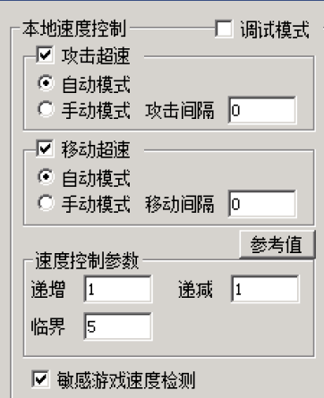
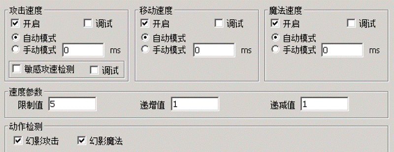

# 加速外挂问题

很多人会问我们，G盾可以封多少外挂，我说已知的都封，他们笑笑表示不信。
100%封挂并不难，现在的问题在于，一天24小时可以保持多久小时外挂无法使用，当外挂可以使用的时候，有没有其他的方式来应对。
一天24小时保持没有外挂可以过检测，那是不可能的。如果可能，只要保持这种节奏1-2周，所有外挂商都会倒闭了。这么多年了，也没见外挂会倒闭。

我们封杀一个外挂，外挂作者总会想办法重新找其他方式来把外挂开起来，所以比的就是效率比的就是速度。现在外挂更新都是内部发售，和N年前的网站发布，群内@全体完全不一样了，这导致外挂的采集也产生不小的困扰。我希望各位在发现服里有开挂玩家之后可以取证截图和列表发给我们，我们也好得知外挂更新了马上就会去关注。

在外挂都被检测的时段，没啥好说的，开挂就掉线。在外挂更新之后到G盾还没云更新的这段时间，就需要G盾的智能限速系统了。
A版

B版

**这道检测保证了外挂在任何时候都无法把速度拉太快，而智能微调。**

**这里的限速是智能限速，他限定了游戏的某个人物的最快速度（带不同装备会得出不同的速度）**

**我们在这里设置了一个阀门，如果外挂加速超出了这个数值那么必掉线。****这个快速速度和玩家日常速度之间的差值就是外挂可以微调的地方**

**这个差值，在复古服会非常小，在出刀快的服差值也很大，所以我们有必要学会怎样缩小这个差值，这个设置方法下文有教程专门来说。**

除此之外，还可以使用rungate上的限速系统，不要瞧不起rungate，在知道正确设置方法之后，有的时候还是有点用处的。单靠rungate肯定是不行的，配合G盾限速之后，再最后补上rungate的限速是最好不过的了。

总结：对于出刀慢的服，限速啥的都可以做道精确，对于出刀很快的服，要精确几乎不可能，速度越快，出刀速度就越受网络波动影响，网络越好出刀速度越快，开了代理和不开的差距很大。而且全国那么大，线路那么多，要做到完全公平几乎不可能。
