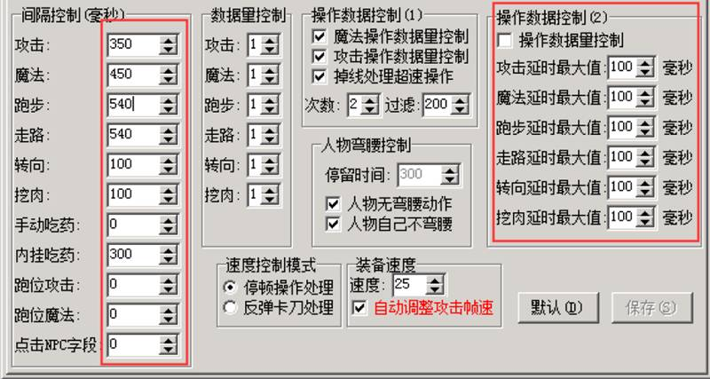

# 跑步卡出刀卡

### **这个问题归根结底来说，还是网络的问题和版本问题**

比如：游戏里跑步，跑一步需要460ms，跑步动作开始的时候，会发送一段数据到服务端，这个传输的过程需要十几毫秒到200多毫秒，然后服务器收到之后M2会计算并应答这个请求，应答的数据再原路返回到玩家电脑，如果在跑一步460ms这个时间内为返回，那么就卡顿了。
很多人会觉得400多毫秒的时候，怎么也够了吧，服务器ping值延迟才20ms左右。但是实际上还真不好说，如果M2应答请求的时间比较长呢？

这图片里，左侧的数值会影响M2应答请求，如果跑步间隔设置的很大，跑步就可能卡顿，右边的操作数据库控制也是。
在复古服里速度普遍慢，感觉并不明显，现在大多服速度都快。所以我们需要把右边的操作数据控制直接关闭。左边的攻击，跑步，走路的间隔都设小点，可以让游戏流畅一些。

然后就是G盾，出刀不卡这个功能了，这个功能可以解决一切出刀不流畅。

最后还有一种情况，部分版本里带的QF,QM里脚本写的不好，导致游戏内玩家，经常行卡动画，小退、飞随机、回城马上就不卡了，但是1-2分钟之后再次卡顿。 这种卡顿我遇到过几次，就连点了出刀不卡都不能让出刀流畅起来。这种的建议换个底板重新做版本。
