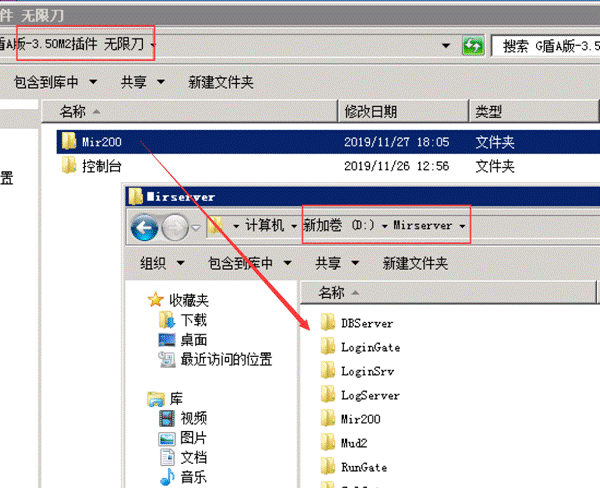
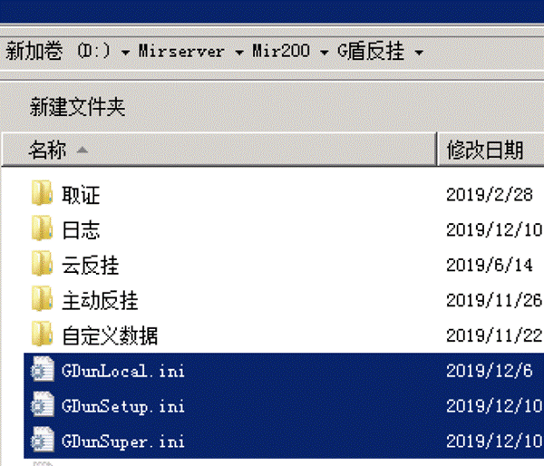

# 如何版本升级

### **A****版更新：**

A版的更新只能关区更新。
我们下载好新版本，解压开，我们可以看到有一个mir200文件夹。然后我们关区，只需要把G盾的mir200覆盖版本里的mir200就好了。

然后启动游戏。
注意：这样升级之后，G盾的设置的选项又会重新变为默认配置。如果你之前版本使用的时候，对G盾的一些参数进行了更改，现在你还需要手动更改一次。
更改之后，我们打开\Mir200\G盾反挂 ，这个文件夹，可以看到

这3个就是当前区的G盾保存的文件，更改好之后，可以把这3个文件保留。 其他区如果需要升级，覆盖了mir200之后，再把这3文件覆盖到其他区的\Mir200\G盾反挂里面，就不需要挨个区调了。

B版更新
推荐使用最新的6.0以上的B版，可以在线升级！
