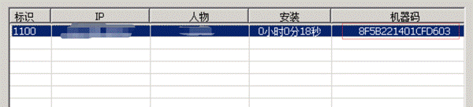
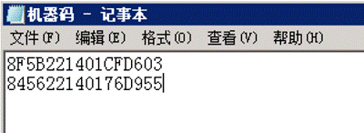

# 如何封号

### **如何封号**

游戏内总有一些开挂的，恶意辱骂的，恶意捣乱的玩家需要封号处理的。
一些新手管理员并不了解如何封号，这里我们简单说明下，希望可以对各位有一些帮助。
1.账号的处理，对于需要处理的玩家，账号一定要处理。
处理账号的方法一般有：拉进坐牢或者改掉账号的密码，生日，问题答案。后面一种方法通俗好用，简单暴力。
2.关于IP：
IP就是上网的时候分配得到的IP地址，IP地址是可变得，比如开个27代理，比如重启下路由器就变了，所以封IP用处不大。
3.机器码：
这游戏有自带的机器码获取功能，可以用于二级密码保护，也可以用于封机器码，在游戏网关的选择-安全过滤中可以进行封机器码。这种机器码可以用于大多数情况，但是有时候玩家可以使用一些黑客工具来修改机器码。
4.G盾机器码：
这是我们提供的一种机器码，比引擎自带的机器码好一些，也可以用于封机器码。
在G盾插件-在线列表里可以看到玩家的机器码，把机器码加入到此处的黑名单，就可以了，但是需要切记直接把玩家机器码加入进去之后应用，玩家是不会掉线的，需要应用之后再手动T玩家下线，那么下次他再上线就不行了。这是单区封机器码。

如果在G盾控制台里的机器码黑名单里对玩家封号，则会整个服务器上所有区都封此机器码。

最后是解封：
如果使用G盾的封机器码封了某个玩家，玩家无法上线。如果要解封很多人直接把黑名单列表清空了，然后发现玩家还是无法上线。这是因为这里点规则是：

**黑名单必须要保留一行，不能全空，可以随便输入一个不存在的机器码留在黑名单****txt****里，不要全部清空**。
