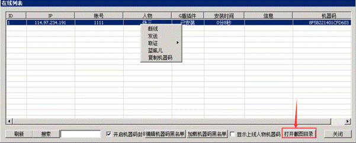
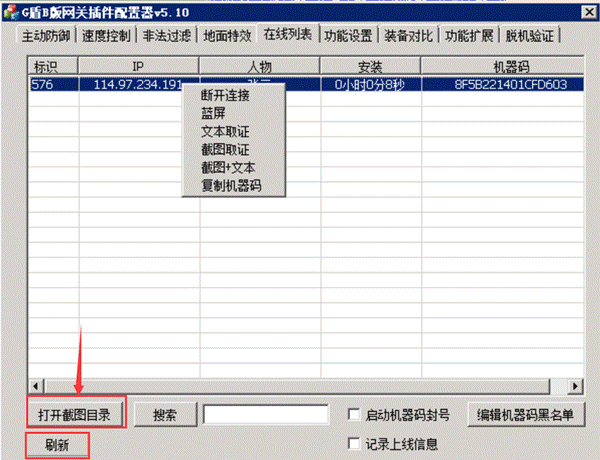

# 如何取证桌面截图

如何取证玩家电脑桌面和进程呢，老用户都知道，最近一些新用户还不知道。
A版
点击M2上的G盾插件-在线列表

选择一个人物，右键点击，这里出现一个菜单，可以蓝屏,T人，复制机器码，再就是截图和文本了。截图就是取电脑桌面，文本是电脑进程。获取之后的文件保存在哪呢？ 点击打开截图目录就看到了。建议图片拉到自己电脑打开，服务器上打开图片会很卡。
B版
点击网关上的G盾插件，然后选择在线列表页面，先点刷新，不点刷新是空白哦！

刷新出了人物之后，选择一个人物。右键点击，这里出现一个菜单，可以蓝屏,T人，复制机器码，再就是截图和文本了。截图就是取电脑桌面，文本是电脑进程。打开截图目录就可以看到文件保持在哪了，建议图片拉到自己电脑打开。

