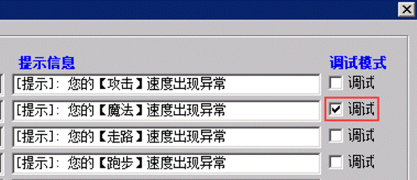
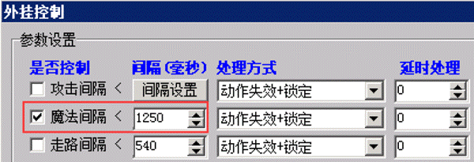

# 实战演练之A版魔法速度

G盾A版因为协议传输问题，导致很多的魔法加密数据会丢失。所以A版无法实现限速魔法，如果游戏内有A版但是又并不想使用B版的用户，可以使用rungate对魔法进行简单的设置。
方法：打开网关上的选项-外挂控制， 找到魔法那一行，最右边有一个调试，打勾

然后进游戏，连续使用魔法技能，随便什么技能都一样的，按住快捷键不放或者猛按快捷键，然后看看网关上调试信息。

```
[2019/12/13 4:13:19] [调试模式]:角色(李四),IP(11.11.11.11),动作(使用魔法:1),使用间隔(1360)
```

```
[2019/12/13 4:13:21] [调试模式]:角色(李四),IP(11.11.11.11),动作(使用魔法:1),使用间隔(1344)
```

```
[2019/12/13 4:13:22] [调试模式]:角色(李四),IP(11.11.11.11),动作(使用魔法:1),使用间隔(1359)
```

```
[2019/12/13 4:13:23] [调试模式]:角色(李四),IP(11.11.11.11),动作(使用魔法:1),使用间隔(1406)
```

```
[2019/12/13 4:13:25] [调试模式]:角色(李四),IP(11.11.11.11),动作(使用魔法:1),使用间隔(1360)
```

```
[2019/12/13 4:13:26] [调试模式]:角色(李四),IP(11.11.11.11),动作(使用魔法:1),使用间隔(1359)
```

可以看到出现的最多的是1360，如果测试的电脑网络还算稳定的话，我们姑且可以认为，魔法速度是1360，然后我们需要在这个值基础上多放松一些。比如：1300，当然也可以再多放松一些，1250。对于这么慢的魔法来说，放松个50-100影响很小的。



以上数值，如果反馈的超速的人很多，可以适当的再减少10-20，一般来说，按照这样来做，不会有问题
