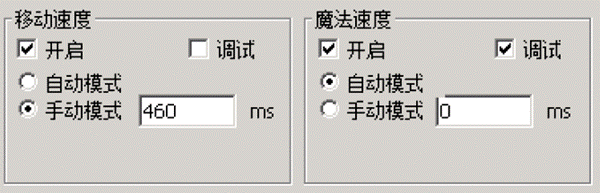
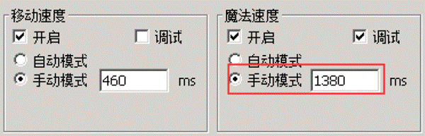
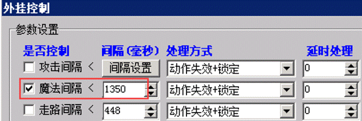

# 实战演练之B版魔法速度

B版魔法速度调试
在B版网关上点击启动器，在速度控制页面，找到魔法速度，点击调试

然后进入游戏，最快速度连续释放魔法，然后看网关上出现的调试速度。

```
[2019/12/13 4:34:00] 李四 (调试模式) 技能间隔正常 计算:1150 实际:1404 累加值:0
```

```
[2019/12/13 4:34:01] 李四 (调试模式) 技能间隔正常 计算:1150 实际:1420 累加值:0
```

```
[2019/12/13 4:34:03] 李四 (调试模式) 技能间隔正常 计算:1150 实际:1482 累加值:0
```

```
[2019/12/13 4:34:04] 李四 (调试模式) 技能间隔正常 计算:1150 实际:1404 累加值:0
```

```
[2019/12/13 4:34:05] 李四 (调试模式) 技能间隔正常 计算:1150 实际:1435 累加值:0
```

```
[2019/12/13 4:34:07] 李四 (调试模式) 技能间隔正常 计算:1150 实际:1404 累加值:0
```

```
[2019/12/13 4:34:08] 李四 (调试模式) 技能间隔正常 计算:1150 实际:1404 累加值:0
```

可以看到实际值最小是1400，但是G盾的计算值有点偏小，这时候，我们可以使用手动模式来设置。
我们可以在G盾上手动模式设置1380

最后我们根据1400的速度，设置下rungate上的限速，我们放松50ms，设置1350



以上数值，如果反馈的超速的人很多，可以适当的再减少10-20，一般来说，按照这样来做，不会有问题
