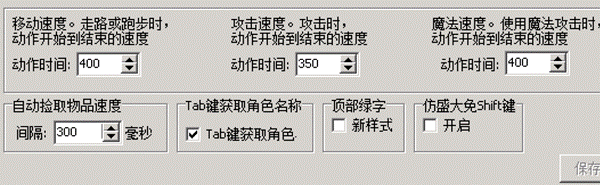
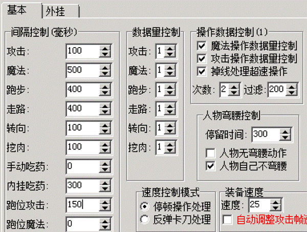
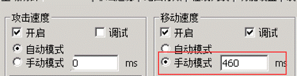
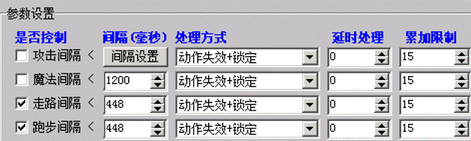

# 实战演练之移动速度

实战演练之移动速度

这里会简单介绍一种比较普及的移动速度的封法。
我们先看下一个客户案例
游戏内的所有速度的表示，都是数值大表示慢，数值小表示快。

内挂移动速度400，间隔跑步走路也是400，没有脚本加速，所有玩家跑步速度相同。
那么我们再看G盾的调试模式数值

[2019/12/12
15:08:44] 张三 (调试模式) 跑间隔正常 计算:400 实际:468 累加值:0

[2019/12/12
15:08:44] 张三 (调试模式) 跑间隔正常 计算:400 实际:468 累加值:0

[2019/12/12
15:08:45] 张三 (调试模式) 跑间隔正常 计算:400 实际:484 累加值:0

[2019/12/12
15:08:45] 张三 (调试模式) 跑间隔正常 计算:400 实际:468 累加值:0

[2019/12/12
15:08:46] 张三 (调试模式) 跑间隔正常 计算:400 实际:468 累加值:0

可以看到，G盾计算是400，也就是说，G盾给这区的智能限速是400。玩家如果速度太快，数值上就低于400，越快速度值就越低，低于400开挂玩家才会被T。

但是呢，玩家都是达不到这么快的数值的，他们很多都会慢点，都在468-515之间徘徊。这个差值足有60-110了，这样的区，如果外挂被检测期间还好，如果是外挂可以开的时间段，开挂的玩家可以使用外挂进行微调，把自己跑步速度调到400多一点，不快于G盾的限速线，这样速度会比正常玩家快的多。

这种服和调的比较完美的服对比下来，简直就是用了2种反挂插件。 因为客户众多，我们没办法给大家一一调试，所以大家尽量学会。
首先，需要增加内挂这里的400数值，先缩小一点计算值和实际值的差。 这里经过我多次调试，游戏小退，然后发现内挂设置445，挺合适的，我们看现在的信息。

[2019/12/12
15:12:53] 张三 (调试模式) 跑间隔正常 计算:445 实际:468 累加值:0

[2019/12/12
15:12:53] 张三 (调试模式) 跑间隔正常 计算:445 实际:468 累加值:0

[2019/12/12
15:12:53] 张三 (调试模式) 跑间隔正常 计算:445 实际:468 累加值:0

[2019/12/12
15:12:54] 张三 (调试模式) 跑间隔正常 计算:445 实际:453 累加值:0

[2019/12/12
15:12:54] 张三 (调试模式) 跑间隔正常 计算:445 实际:468 累加值:0

[2019/12/12
15:12:55] 张三 (调试模式) 跑间隔正常 计算:445 实际:468 累加值:0

[2019/12/12
15:12:55] 张三 (调试模式) 跑间隔正常 计算:445 实际:468 累加值:0

可以看到，相比之前的信息，实际值几乎一样，还是468-480，偶尔出一个540那不需要管，说明是网络不好顿了一下。 但是，这时候计算值是445，G盾限速阀是445了，计算下差值，差值只有20-40了。调到这里已经算不错的了，外挂如果可以开的时候，能微调的幅度相当有限。
而且我们还可以继续调， 我们发现，实际的数值最小的也是468，不会有更小的了。
我们可以使用G盾的手动模式，进一步的限速，打开G盾插件-速度控制这里，攻击速度设置为手动模式，数值设置成460。

然后小退之后，再看调试信息：

[2019/12/12
15:17:24] 张三 (调试模式) 跑间隔正常 计算:460 实际:468 累加值:0

[2019/12/12
15:17:24] 张三 (调试模式) 跑间隔正常 计算:460 实际:484 累加值:0

[2019/12/12
15:17:25] 张三 (调试模式) 跑间隔正常 计算:460 实际:468 累加值:0

[2019/12/12
15:17:25] 张三 (调试模式) 跑间隔正常 计算:460 实际:468 累加值:0

[2019/12/12
15:17:26] 张三 (调试模式) 跑间隔正常 计算:460 实际:483 累加值:0

[2019/12/12
15:17:26] 张三 (调试模式) 跑间隔正常 计算:460 实际:468 累加值:0

[2019/12/12
15:17:27] 张三 (调试模式) 跑间隔正常 计算:460 实际:468 累加值:0

[2019/12/12
15:17:27] 张三 (调试模式) 跑间隔正常 计算:460 实际:468 累加值:0

这样，G盾限速误差被缩小到10以内，堪称完美。

那种带上什么装备，就加移动速度的，有多个不同移动速度的游戏，是不随便能用G盾手动模式的，如果非要设，那就带上移动速度最快的装备调试。
最后，我们可以设置下游戏网关上的速度，很多人都不会设置网关，网关上的调试数值受网络波动比较大，玩家网络差网络波动大，容易导致不准。所以要放开一些限制，最主要的是，没有一个精准的参考目标。其实我们可以用G盾上的调试出的数值来作为基准。在G盾调试上，我们可以看到内挂跑步445的情况下，玩家最小跑步速度468，还有一些484，515，但是最小不会低于468，这时候我们和G盾设置一样严格的460，对大多数服来说都太危险了，一般我们可以放松一点，毕竟网关限速只是对于G盾限速的补充，并不是主打。我们放松20点，设置448
这样设置

最后说一句，其实对于大多数游戏来说，跑步的真实速度都是468，如果是的话，上述配置可以照抄。
