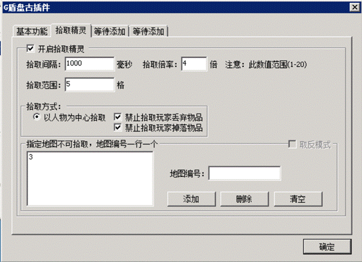

# 使用G盾盘古捡物的方法

使用G盾盘古捡物的方法

使用G盾盘古自动捡物的方法：

G盾盘古插件是G盾的专用功能扩展插件，正常使用G盾的客户无需客户端插件，只需安装盘古的M2插件就可以安心使用。如果要使用盘古插件做版本，只需要使用登陆器配置的时候集成盘古单机客户端插件，并安装上盘古M2插件就可以，在人数不超5人的情况下可以免费使用。
视频教程：

文字教程：
1.把盘古M2插件安装好，A版顺序为

IPLocal.dll

945Engine.dll

PGM2Plugin.dll

M2Plugin.dll

B版顺序为

IPLocal.dll

945Engine.dll

PGM2Plugin.dll

2.开启插件上的功能

3.使用脚本命令开启捡物功能
开启命令PGStartAutoPickItem
1
关闭命令PGStartAutoPickItem
0
安装好插件之后，使用开启命令来让某玩家启动捡物功能，这样我们可以延申出多种用法：
a.把PGStartAutoPickItem
1写入到QM的登陆触发里，可以让所有人上线都自动开启此功能。
b.可以通过脚本检测玩家的等级或者赞助之类的，让只有达到一定要求的玩家才拥有此功能。
c.可以让玩家点击NPC自动开启，但是开启的时间有限，每开启一次扣费xxx。
d.可以使用关闭命令来让晚上攻沙时间点关闭此功能，攻沙结束再次自动开启。

PGSetAutoPickItemInterval
1000
控制玩家捡物的速度的，1000=1秒一次，如果是500的话就是1秒2次。
PGSetAutoPickItemRange 2
控制玩家捡物的范围的，参数2表示玩家捡物范围=以玩家为中心上下左右各2格，总共25格的范围。
我们可以通过这2个命令来对玩家给予不同档次的捡物功能。
