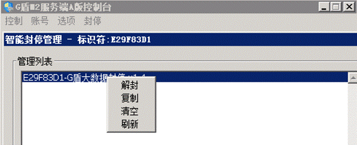

# 玩家被G盾封号

玩家被G盾封号

**有时候你们会遇到玩家说被封号**

G盾有大数据智能封号，凡是被封号的玩家会上线就掉线，并被提示联系GM，这个系统目前几乎0误封。如果需要解封，在G盾控制台上点智能封号管理，选择人物右键解封即可，解封之后刷新一次，立刻就解开了。

**我们做这套系统的用于在于：**

在之前的时间内，对于用挂的玩家掉线的处罚几乎=0，你们不会看几天多少人开挂被T下线。 对于玩家来说，外挂更新了我就开，外挂被封了我就不开。爱用挂的玩家就这样养成了开挂习惯，游戏内不管消费还是不消费，外挂肯定都是要买的，这种模式下只要玩家爱用，外挂永远封不完，封死一波又一波。

**最近有人和我们反馈，整个行会攻沙期间****100****多人集体开挂。他们不怕掉线，一场攻沙掉线几千人次。****他们只要赢，上了免费挂****1****分钟掉线，掉线之后重新上。在上挂的时间内，他们据说只要****30****秒就把对方推平。**
这种情况必须要得到遏制，所以智能封号系统出现了。只要敢开挂，就有可能被封号，开挂无限掉线攻沙的，号会被封光。买收费挂的内部挂的，除非一次都别被检测到，检测到一次，可能号就被封了。现在的准确率非常之高，凡是被封号的几乎都是开挂玩家，请各位在给别人解封的时候好好斟酌一下。
