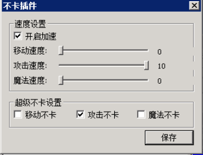

# 无限刀如何使用

### **需要使用无限刀功能的各位注意了：**

1.不卡插件里面，有三个速度，移动，攻击，魔法

**不建议使用移动速度，之前有客户使用移动速度之后，导致游戏内跑步的时候看别人会有残影，这是有几率出现的并不是所有都是，****但我们依然不建议使用，移动速度我们可以在****M2****上自行调节，一般而言移动速度不需要太快，太快了无法掌握游戏节奏。****所以一般拉动攻击，魔法则按照需求来。**

2.移动不卡，出刀不卡，魔法不卡。
