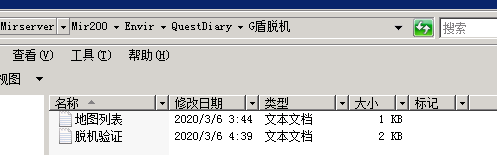
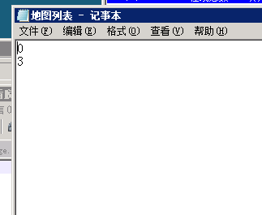

# G盾B版5.17防脱机验证脚本

G盾B版5.17防脱机验证脚本

**1.QF****脚本中加入以下脚本**

[@G盾脱机验证成功]

#if

#act

#CALL [\G盾脱机\脱机验证.txt] @验证成功

[@G盾脱机验证失败]

#if

#act

#CALL [\G盾脱机\脱机验证.txt] @验证失败

[@G盾加载成功]

#if

#act

#CALL [\G盾脱机\脱机验证.txt] @加载成功

**2.QM****登陆脚本中添加一个定时器，并定义好时间，例子中脚本为****5****分钟即****300****秒**

[@Login]

#if

#act

SetOnTimer 150 300

**3.QM****脚本中添加定时器脚本**

[@OnTimer150]

;取一个随机值，随机到则开始进入验证

#if

#act

MOVR N$G盾\_验证随机值 100

;检测玩家所在地图是否添加到了地图列表，如果是则进入验证流程并将验证次数变量清零

#if

Small N$G盾\_验证随机值 50

#act

#CALL [\G盾脱机\脱机验证.txt] @脱机验证

break

;如果该次随机没有则累加一次验证次数

#if

#act

Inc N$G盾\_验证次数 1

;如果验证次数达到累计数值，则强制进入验证

#if

Large N$G盾\_验证次数 5

#act

#CALL [\G盾脱机\脱机验证.txt] @脱机验证

**4.Mir200\Envir\QuestDiary****目录下新建一个文件夹取名为****G****盾脱机，将下载的压缩包中的****2****个****txt****文本放入此文件夹中，如下图**

**5.****将需要进行验证的地图的编号逐行写入地图列表****.txt****中，如下图**

**脚本压缩包请点击下方链接下载**
[G盾脱机压缩包下载](https://www.lanzous.com/i9zb33g)
