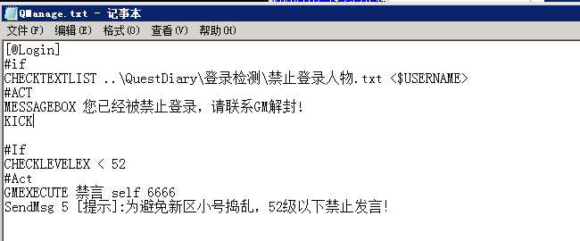
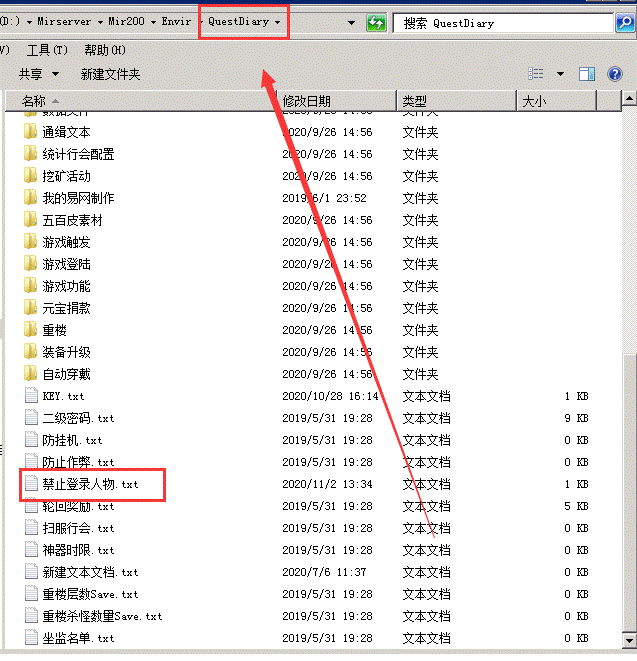

# 脚本禁止玩家登录

脚本禁止玩家登录

第一步 在 QManage.txt 中的[@LOGIN]字段添加下面这段脚本

[@login]
#if
CHECKTEXTLIST ..\QuestDiary\禁止登录人物.txt <$USERNAME>
#ACT
MESSAGEBOX 您已经被禁止登录，请联系GM解封!
KICK

第二步 在QuestDiary文件夹里面新建一个叫 禁止登录人物.txt

第三步 在禁止登录人物.txt写入想要禁止登录的玩家姓名

第四步 重新加载引擎 qm
