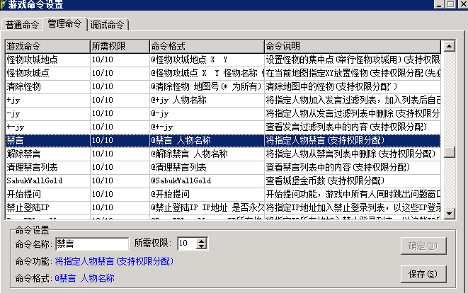

# 脚本命令实现GM命令

普通玩家实现GM命令效果
脚本命令 GMEXECUTE
GMEXECUTE ObServer

其ObServer为COMMAND.INI中设定的G命令后面，可加参数self指对自己
也可在m2游戏命令查看

以下是具体举例：

#If
CHECKLEVELEX < 52
#Act
GMEXECUTE 禁言 self 6666
SendMsg 5 [提示]:为避免新区小号捣乱，52级以下禁止发言！
