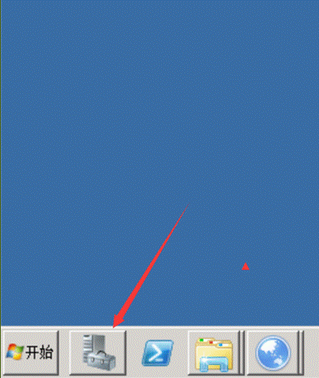
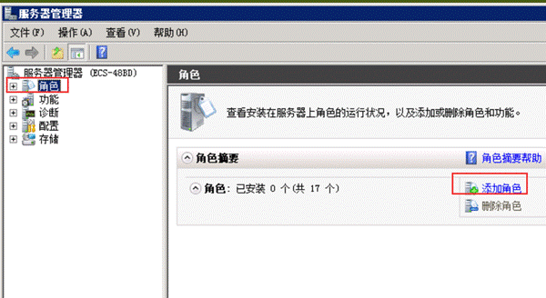
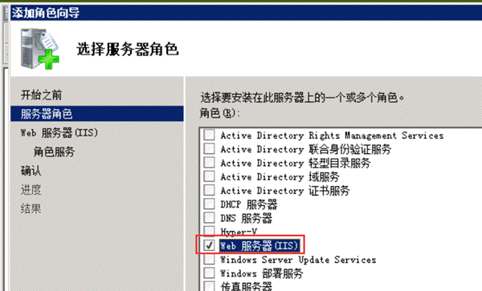
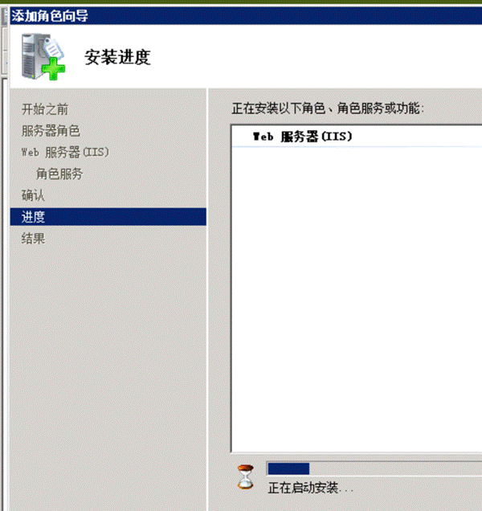
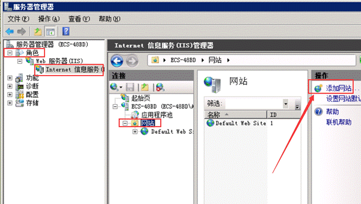
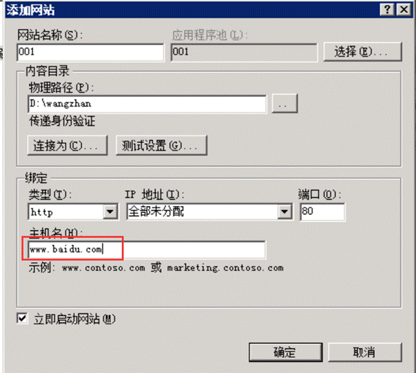
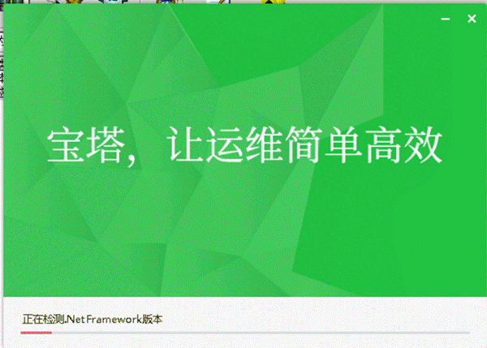
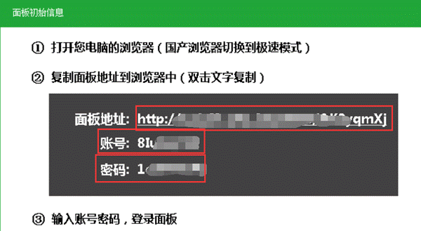
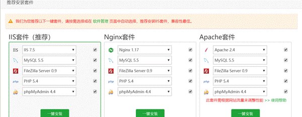
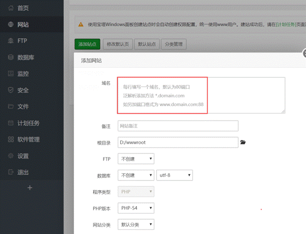

# 搭建网站的几种方法

搭建网站的几种方法：
一些人，连简单的搭建网站都不会，还要请技术帮忙，真是牛B，这里简单介绍下几种办法
一：2003系统下，直接使用IIS，这个太简单了，桌面上就有IIS，打开IIS之后，看下面2008系统的，基本一样！
二：2008系统，一些人说，找不到IIS，我们需要先安装下IIS

然后下一步，下一步，下一步，安装。

等几分钟，安装好

好了，现在IIS安装好，添加网站

我们这里可以使用自己的域名。已经备案的域名可以使用80端口，没备案的就换个端口
除了使用域名，如果我们域名这里为空，则可以使用IP+端口来搭建网站，IDC那边貌似必须使用IP+非80端口，阿里云那边可以使用ip+一切端口

然后，把做好的网站文件解压到d:\wangzhan
就好了！
同理，搭建一个列表txt也是这样，和搭建网站毫无区别。

三：宝塔搭建网站
宝塔面板是个搭建网站的神器，可以搭建常用的静态的网站，也可以搭建论坛之类的动态网站，可以用在windows服务器，也可以用在linux服务器，他还可以在搭建网站的时候顺便把FTP搭建好，真是神器，下面以windows服务器为例
1.百度下白塔面板，下载宝塔的程序，安装

2.他会提示一个网址，账号密码

3.我们在自己电脑上，访问那个网址，输入账号密码登录

如果是干干净净的没安装IIS的服务器，用第一个，如果是以前用IIS了，就用第二个。其实这3个都差不多，都可以使用！
安装好之后，就开始搭建网站吧

这里写域名，如果需要创建FTP就设置下，账号密码。 如果需要创建数据库就点创建，数据库一般只有论坛那些才需要创建，一般用不到。
然后创建了就OK了！ 就这么简单！比IIS好看很多

四：Linux服务器搭建网站
使用putty链接上linux服务器之后，输入宝塔的安装代码，代码去宝塔官网复制
安装成功之后，和上面三，毫无区别！
