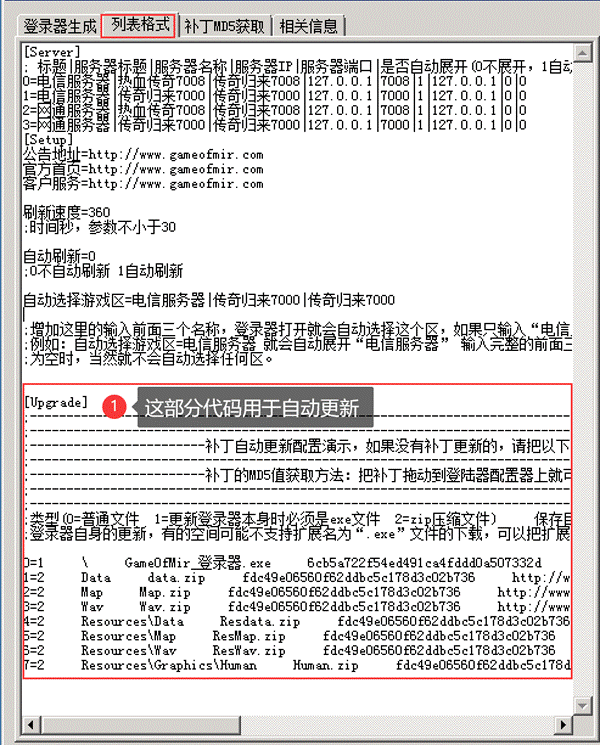
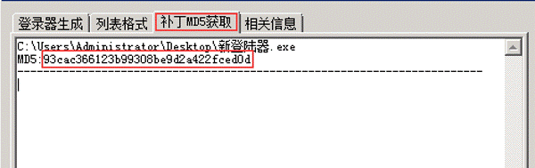

# 登录器自动更新

登录器自动更新

登陆器自动更新

这部分不仅仅是登陆器更新，也可以用于补丁释放，在需要强制玩家更新登陆器的时候还是很好用的

问题：假设，现在你有ABC，三个老的登陆器，用的登陆器列表都是同一个，然后现在配置了一个新登陆器D，我们可以使用这个方法，让使用ABC老版本登陆器的玩家打开登陆器的时候，强制更新到新登陆器D

方法：

1.配置好新登陆器，比如名字叫： 新登陆器.exe

2.弄个网站，比如游戏网站，[abc123.com](http://abc123.com/)，把登陆器放到网站目录下面

浏览器里输入http://www.abc123.com/新登陆器.exe 看看能不能正常下载登陆器，如果能正常下载，看下一步

3.把这个新登陆器.exe，拖到登陆器配置器的获取MD5页面，获取下MD5

得到MD5是93cac366123b99308be9d2a422fced0d

4.根据列表格式，我们根据他原来的格式

[Upgrade]

0=1 \
GameOfMir\_登录器.exe
6cb5a722f54ed491ca4fddd0a507332d [http://www.gameofmir.com/GameOfMir\_登录器.exe](http://www.gameofmir.com/GameOfMir_%E7%99%BB%E5%BD%95%E5%99%A8.exe)

在原来格式的情况下修改下我们自己的参数就行了得到我们自己的代码是：

[Upgrade]

0=1
\     新登陆器.exe
93cac366123b99308be9d2a422fced0d    http://www.abc123.com/新登陆器.exe

把这段代码，放到登陆器列表下，则老登陆器ABC，都会在打开登陆器的时候强制更新到新登陆器
