# 封闭服务器端口

封闭服务器不必要端口
很多人不知道，我们一般使用服务器的时候，用到的端口不多，但是IDC那边的服务器，端口确实默认开放了65535个，一些不必要的端口只会带来更多的安全隐患，下文以2008系统为例，来说下如何封闭端口。
登录服务器的时候，使用的远程链接也是一个端口，我们管他叫3389，在阿里云，腾讯云之类的云主机，都是默认使用3389这个端口，在IDC那边一般都会更改这个端口。
比如现在这台服务器103.216.153.184:45754 他的远程端口就是45754，这个端口我们一定别关，关了我们就远程不过去了。

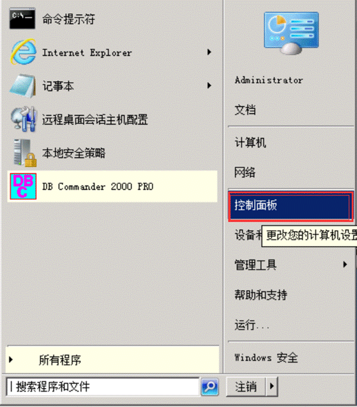
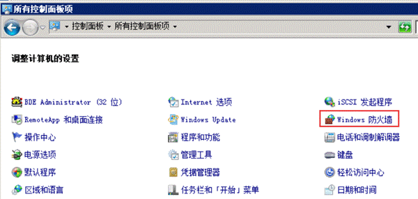
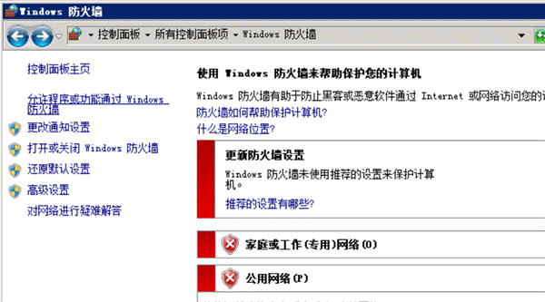
可以看到，windows防火墙基本都是关闭的，我们现在就是要开启防火墙，但是不要直接开启，我们先增加了放行规则再开
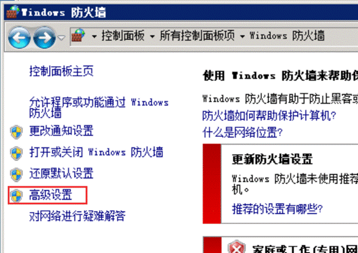
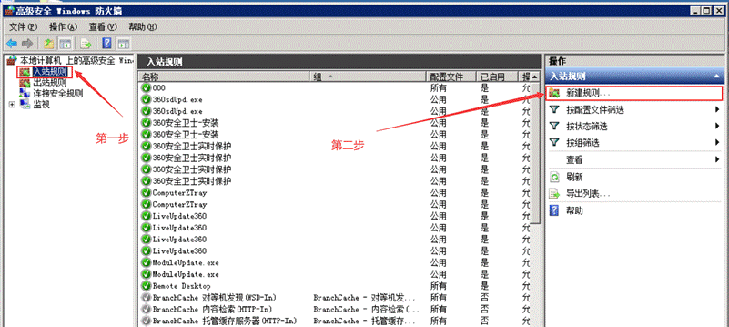
入站规则→新建规则，然后，点端口
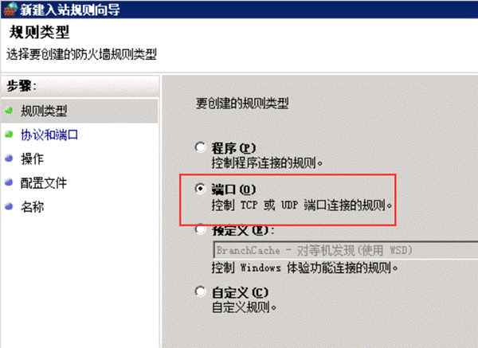
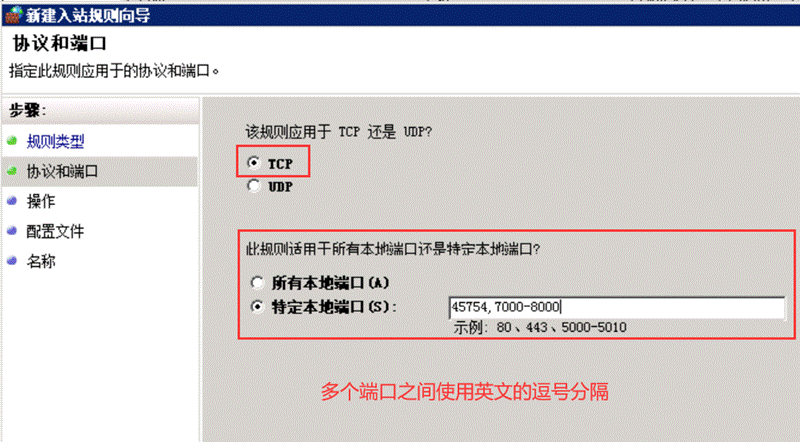

这里的45754，就是我连这台服务器的远程端口，这个记得一定要加上，否则一会规则生效，远程连不上了
7000-8000是我一般用到的对外的各个网关的端口，其他那些端口通通关闭了。
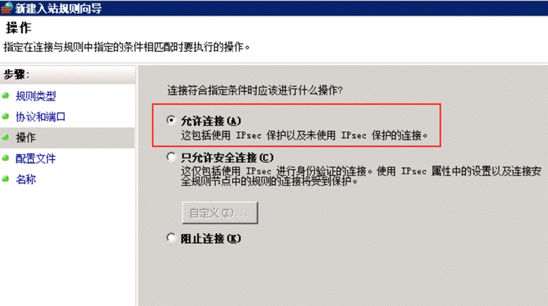
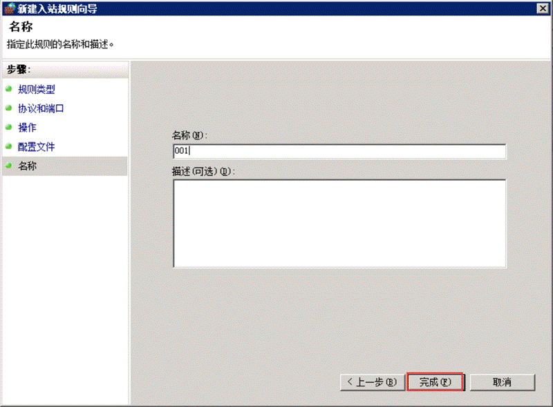

完成之后，这里就多了一条规则了
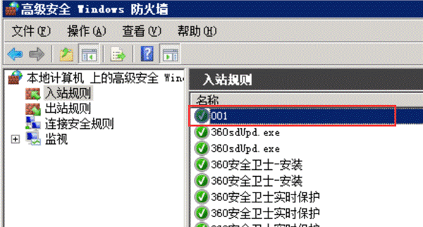
然后
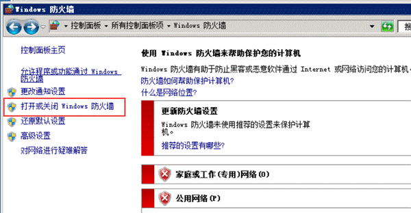
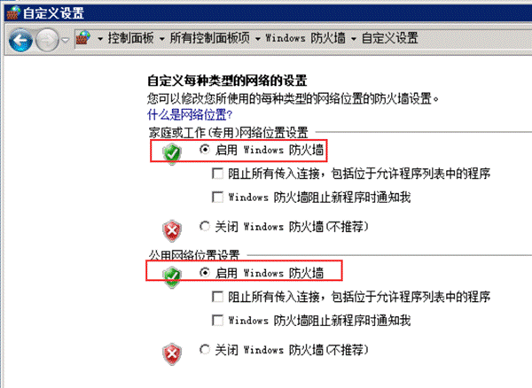
启动防火墙就行了。

有人或许会说，服务器上设置不敢随便改，其实，这个很简单的了，有点动手能力的都可以开启，如果开的不对，那就关闭防火墙就正常了，开关之间，机器不需要重启啥的
一些人担心失误了，导致远程连不过去。这里也有一个保险的办法，我们可以在服务器上先安装一个tv远程工具，先用电脑上tv工具，远程连上服务器，这样就算翻车了，windows远程不了了，我们的tv远程工具还是可以继续控制服务器，然后把防火墙关闭，一切恢复原先。

tv工具下载地址
<https://www.teamviewer.cn/cn/>
我们这边一般使用tv13版本，下载地址
<https://www.lanzous.com/i4eeoqh>

最后，说一下，怎么看端口是不是封闭成功了，很简单的办法，搭建个区，端口使用1w以上的，然后看看登陆器上显示端口是不是关闭的，如果是关闭的，说明端口封闭成功了！
